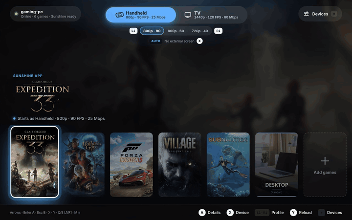
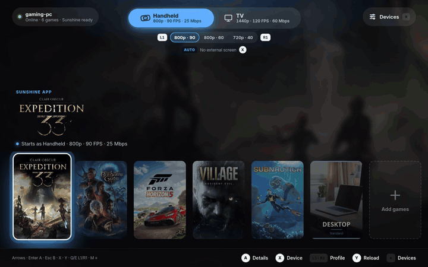
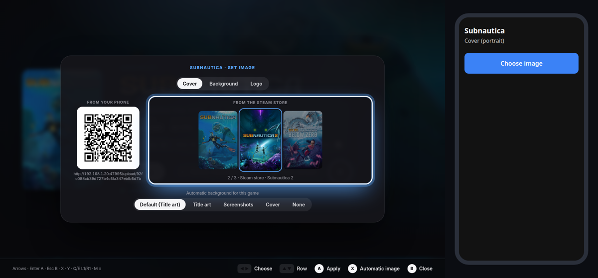
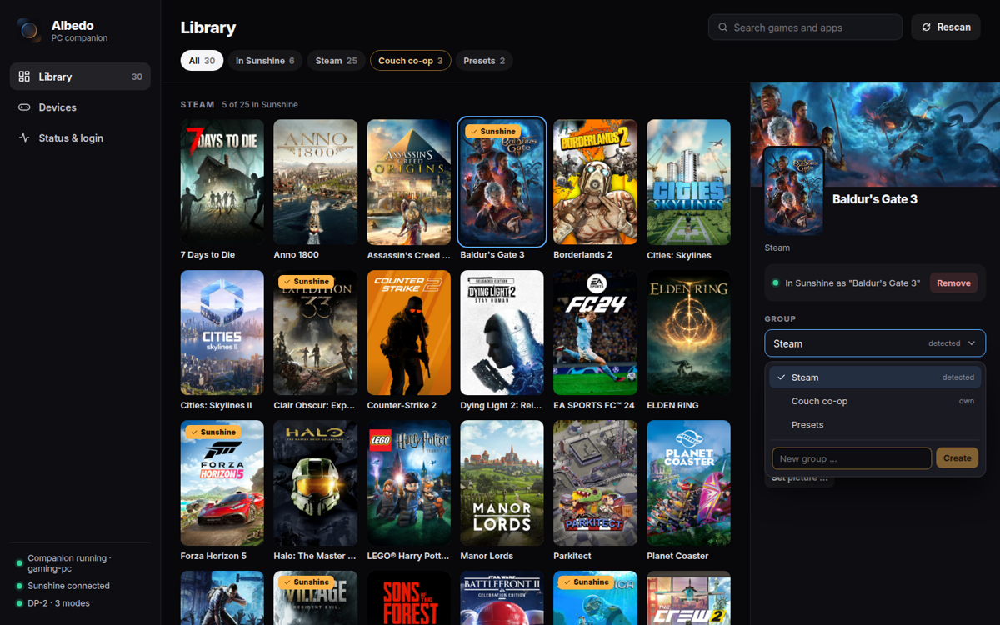
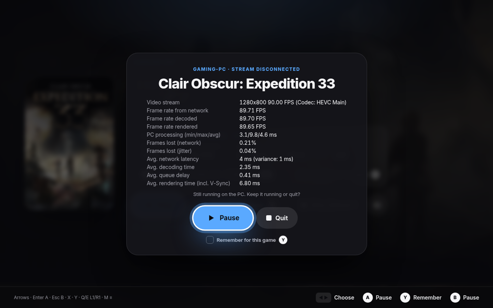

<div align="center">
  
</div>

# Albedo – A Controller Launcher for Moonlight on the Steam Deck 🎮

> [!CAUTION]
> **Not every feature works on every PC yet.** The PC side is built for and tested on
> **KDE Plasma (Wayland) with an AMD GPU** only. Albedo on the Deck and plain Sunshine streaming
> work with any PC that runs Sunshine, but switching the PC's screen to the Deck's resolution
> relies on KDE tools and a kernel feature only known to work with AMD's driver.
> See [Requirements](#requirements-) for what needs what.

<p align="center">
  
</p>

---

## Installation 💻

### Steam Deck 🕹️

Switch to **Desktop Mode**, open **Konsole** and run:

```bash
curl -fsSL https://raw.githubusercontent.com/Dav1d-Fn/Albedo/main/deck/install.sh | bash
```

The script

- downloads the newest AppImage to `~/Applications/`,
- offers to install Moonlight (Flatpak) if it is missing,
- asks before closing Steam, then adds Albedo as a **non-Steam game** with cover, hero, logo and
  icon, and starts Steam again.

Running it again updates the entry instead of adding a second one (a hand-made entry for the
AppImage is picked up, too). `shortcuts.vdf` is backed up first (`shortcuts.vdf.bak-…`).

Back in **Game Mode**, start Albedo and **pair** it once: pick your PC, press *Koppeln* and type the
PIN it shows into Sunshine's web UI under *PIN*.

To remove it again:

```bash
curl -fsSL https://raw.githubusercontent.com/Dav1d-Fn/Albedo/main/deck/install.sh | bash -s -- --uninstall
```

**Updates** come from the app itself: when a new release is out, Albedo asks on start, **A**
installs it and restarts.

### Gaming PC 🖥️

Albedo only needs [Sunshine](https://github.com/LizardByte/Sunshine) on the PC to list and start
games. For adding games from the couch, cover art and picture upload, install **Albedo Companion**
on the PC (Linux) – open a terminal and run:

```bash
curl -fsSL https://raw.githubusercontent.com/Dav1d-Fn/Albedo/main/pc-setup/install.sh | bash
```

It starts with your desktop and waits in the tray; running the command again updates it,
`| bash -s -- --uninstall` removes it. Sunshine login, the optional virtual monitor and
troubleshooting are in [PC setup](#pc-setup-) below.

---

## Overview 📋

**Albedo** is the menu you see on the Steam Deck before and after streaming a game from your gaming
PC. It lists the games (Sunshine apps) of the PC with their artwork and starts
[Moonlight](https://moonlight-stream.org/) with the resolution, frame rate, bitrate, codec and HDR
setting of the **device** you are playing on right now. Moonlight does the streaming; when it
exits, you are back in Albedo.

Built with [Tauri 2](https://v2.tauri.app/), [React](https://react.dev/) and Rust, controlled
entirely with the gamepad.

### Why?

- **Moonlight-qt** works great, but its menu is a desktop app: small, not pretty on a TV, and it
  has *one* set of stream settings. Playing handheld at 1280×800 and docked on a 4K TV means
  digging through the settings every time.
- **[MoonDeck](https://github.com/FrogTheFrog/moondeck)** solved a lot of this, but it is no longer
  developed.

Albedo keeps Moonlight for what it is great at and replaces only the menu: one tap on **X**
switches between Handheld and TV, and the whole UI tints with the device (blue / orange) so you
always see which settings are active.

---

## Features ✨

### 📺 Devices & Profiles

Every **device** (Handheld, TV, … add as many as you like) has its own **device settings** (name,
colour, symbol, audio Stereo / 5.1 / 7.1, when it becomes active) and a list of **profiles**:
resolution, FPS, bitrate, codec (H.264 / HEVC / AV1) and HDR.

- **X** switches the device, **L1 / R1** the profile.
- **Y** on a game's detail page remembers the profile for *that game on that device*, e.g. 40 FPS
  for a heavy game in handheld mode.
- **☰** opens the editor *Devices*: on the left *Device settings* and the device's profiles, on
  the right the values of the selected entry. Add, rename, recolor and delete devices and profiles.

<p align="center">
  
</p>

<p align="center">
  
</p>

### 🔌 Automatic Device Detection

Albedo watches the Deck's display outputs. Undocked it picks the device with the rule *Deck ohne
Dock*, docked with a screen the one with *Dock mit Bildschirm*. A device can also be tied to **one
specific screen** by its name (read from the screen's EDID, e.g. `LG TV SSCR2`), so the living
room TV and the desk monitor each get their own settings.

### 🧩 Companion: Add Games from the Couch

With Albedo Companion running on the PC, the last tile on the home screen, **Add games**, lists
everything installed on the PC, grouped by source:

- **Steam** (all library folders) and **non-Steam games** in Steam (with their custom artwork)
- **Emulation** (EmuDeck, RetroArch, Cemu, Eden, melonDS …)
- **Heroic** (Epic / GOG), **Lutris**, **Prism Launcher** (Minecraft instances)
- **Programs** from `.desktop` files, plus presets: *Desktop* and *Steam Big Picture*

**A** turns an entry into a Sunshine app (start command, cover, and a stop command that really
ends the game), **X** removes it again. No editing `apps.json` by hand.

<p align="center">
  
</p>

### 🖼️ Artwork & Pictures via QR Code

Covers, hero images, logos and Steam screenshots come straight from the PC. Don't like a picture?
*Set image* shows a **QR code**: scan it with your phone, pick any image, and it replaces the
cover, hero or logo of that game – on the Deck and in Sunshine.

<p align="center">
  
</p>

### 🖱️ Albedo Companion: Manage It at the Desk

Open [Albedo Companion](pc-app/) from the tray to do the same with mouse and keyboard on the PC: add and remove games,
move a game into another group (or an own one, like *Couch co-op*) when the emulation detection
gets it wrong, set pictures from the picture search or by dragging a file in, pair a device with
its PIN, and enter the Sunshine login. Group changes show up on the Deck too.

<p align="center">
  
</p>

### 🖥️ The PC Screen Follows the Deck

Each game added through the companion switches the PC's (virtual) streaming monitor to the
resolution and refresh rate the Deck asked for, and back when the stream ends. If the PC's screen
can't do a profile exactly, Albedo tells you what you will actually get.

With the virtual monitor set up, a missing mode can be added right from the profile editor on the
Deck: **Y** (*Add on PC*) asks Albedo Companion to put it into the virtual monitor's EDID. The PC
shows a password prompt first, so nothing changes without you.

### ⏰ Wake-on-LAN

When the PC is asleep or off, **Y** on the home screen wakes it with a magic packet and waits for
Sunshine to answer. It works on the home network once Albedo has connected to the PC there once;
the PC needs Wake-on-LAN enabled in its BIOS and network driver, see
[docs/wake-on-lan.md](docs/wake-on-lan.md).

### ⏹️ After the Stream

When Moonlight disconnects, Albedo asks whether the game should keep running on the PC
(*Pause*) or be closed (*Quit*). **Y** remembers the answer, per game if you like.
Optionally it also shows Moonlight's statistics of the stream: frame rates, latency and lost frames.

<p align="center">
  
</p>

### 🌐 Home & Away

Albedo finds Sunshine PCs on the network via mDNS. It tries the home address first and extra
addresses (e.g. [Tailscale](https://tailscale.com/)) after that, so the same setup works on the
road.

### 🔄 Self-Update

Releases are signed. The AppImage checks GitHub on start and updates itself after you confirm.

---

## Requirements 📋

> [!NOTE]
> The interface speaks **German and English**. It follows the system language until you pick one under Connection → Language.

### Steam Deck

- SteamOS 3 (Game Mode)
- [Moonlight](https://flathub.org/apps/com.moonlight_stream.Moonlight) as Flatpak – the installer
  offers to install it

### Gaming PC

| What you want | What the PC needs | Works on |
|---|---|---|
| List and start games | [Sunshine](https://github.com/LizardByte/Sunshine) | Any OS Sunshine runs on |
| Albedo Companion: add games, artwork, QR upload | Linux, `curl`, `magick` (ImageMagick), `gio`, `sqlite3` (Lutris only); a tray (StatusNotifier) to open the window | Any Linux desktop; the program list reads `.desktop` files. Without a desktop: `--headless` |
| Screen follows the Deck's resolution | `kscreen-doctor`, `jq`, `sunshine-match-client` (from [`pc-setup/`](pc-setup/)) | **KDE Plasma only** |
| Virtual monitor without a real screen | DRM debugfs `edid_override` / `force` on a free connector | **Tested on AMD only** |

What exactly depends on what:

- **KDE Plasma.** The companion reads the modes of the streaming monitor with `kscreen-doctor -j`,
  and the games it adds run `sunshine-match-client` before the stream (saves your screen layout,
  then switches to the virtual monitor with `kscreen-doctor`) and `sunshine-match-client --restore`
  after it (puts the saved layout back). On GNOME, Sway, Hyprland or X11 those steps fail; the stream still starts, but at whatever
  resolution the PC screen has.
- **AMD GPU.** The virtual monitor is a real but unused connector (`DP-3` on the test machine)
  that is forced to *connected* with a custom EDID through
  `/sys/kernel/debug/dri/*/<connector>/edid_override` and `force`. This is a kernel DRM feature; it is
  tested with `amdgpu` only. Intel may work, the proprietary NVIDIA driver most likely doesn't
  offer it. If you already have a dummy plug or another virtual display solution, you don't need
  this part.
- **Connector name.** You pick the free connector during setup; it is stored in
  `~/.config/sunshine-match-client.conf`, which the script and the companion read.

The *Desktop (ohne Profilwechsel)* preset and games you add to Sunshine yourself skip all of this
and work on any setup.

Tested on: Steam Deck with SteamOS 3, Fedora with KDE Plasma 6 (Wayland) and an AMD GPU.
If you get it running on something else, please [tell us](https://github.com/Dav1d-Fn/Albedo/issues).

---

## PC Setup 🛠️

### 1. Sunshine

Install [Sunshine](https://github.com/LizardByte/Sunshine), set a web UI login and make sure
Moonlight can connect. That is all Albedo needs to list and start games.

### 2. Albedo Companion

Installed with the one command from [Gaming PC](#gaming-pc-) (no Rust or Node needed). The
script downloads `Albedo-Companion-x86_64.AppImage` from the latest
[release](https://github.com/Dav1d-Fn/Albedo/releases), checks it against `SHA256SUMS`, installs it
to `~/Applications/` with a menu entry and an autostart entry, and starts it in the tray. An older
setup with the separate `albedo-companion` (or `streaming-launcher-companion`) service or the
*Albedo PC* app is replaced; its config stays.

At login it starts straight into the tray (`--hidden`). Click the tray icon and pick *Open* for the
window; closing the window puts it back into the tray (the window is dropped then, so it uses little
memory in the background), *Quit* in the tray menu ends it, and the Deck can no longer add games
until you start it again. Starting it a second time only brings up the window.

On a PC without a desktop, run `Albedo-Companion-x86_64.AppImage --headless` (for example from your own
systemd user service): only the companion, no window, no tray. Developers build from a checkout
with `pc-setup/install.sh --build` (needs Rust and Node).

On first start it creates `~/.config/albedo-companion/config.json` (readable only by
you):

```json
{
  "port": 47995,
  "sunshineUrl": "https://localhost:47990",
  "sunshineUser": "",
  "sunshinePassword": ""
}
```

Leave the login empty: the first time you press **A** in *Add games*, Albedo asks for the Sunshine
login (or enter it under *Status & login* in Albedo Companion), and the companion stores it. Without it the
list still shows, but adding and removing don't work. After editing the file by hand, quit and
start Albedo Companion again.

Open port **47995/tcp** in the firewall. The companion only answers the home network
(private IPv4 ranges), Tailscale (`100.64.0.0/10`) and localhost, and it never runs commands
sent by the client: it only creates Sunshine apps from games it found itself. The full API is in
[`companion/API.md`](companion/API.md); the window is described in [`pc-app/`](pc-app/README.md).

Check that it runs:

```bash
curl -s localhost:47995/api/health
```

### 3. Virtual monitor & resolution switching (KDE + AMD)

For KDE Plasma (Wayland) with an AMD GPU. The PC gets a virtual monitor on a free connector, and
every stream switches the PC to it at the resolution and FPS of the Deck's profile. Your real
monitors turn off for the stream and come back exactly as they were when it ends.

```bash
curl -fsSL https://raw.githubusercontent.com/Dav1d-Fn/Albedo/main/pc-setup/install.sh | bash -s -- --virtual-monitor --dry-run   # shows what it would do
curl -fsSL https://raw.githubusercontent.com/Dav1d-Fn/Albedo/main/pc-setup/install.sh | bash -s -- --virtual-monitor
```

This is the same installer as in step 2 (in a checkout: `pc-setup/install.sh --virtual-monitor`).
It installs or updates Albedo Companion first, fetches its helper files from GitHub, then

1. checks for KDE Plasma on Wayland, the `amdgpu` driver, `kscreen-doctor`, `jq` and `python3`,
2. lists the free connectors (no monitor plugged in) and lets you pick one; don't plug a real
   monitor into it later,
3. builds an EDID with the stream modes and installs a boot service that forces it onto that
   connector (`virtual-display-edid.service`; asks for your sudo password),
4. installs `sunshine-match-client` to `~/.local/bin` and writes the connector name to
   `~/.config/sunshine-match-client.conf`,
5. optionally stops `xwaylandvideobridge` for the length of a stream (Sunshine `global_prep_cmd`).
   On the first connect after booting, KWin and Xwayland can deadlock while the monitors switch;
   this avoids it. You only lose screen sharing from X11 apps during the stream,
6. shows with `kscreen-doctor` whether the new monitor has the modes. If it doesn't show up yet,
   log out and back in once.

The EDID has 1280×720 (40/60), 1280×800 (60/90), 1920×1080, 2560×1440 (60/100/120) and
3840×2160 (60/100). Add your own with `--mode`, e.g. `… | bash -s -- --mode 3440x1440@100`; the
profile editor in Albedo marks values the PC doesn't have. Run the installer again to change the
connector or the modes.

Test the switch without a stream (prints the command only):

```bash
SUNSHINE_CLIENT_WIDTH=1280 SUNSHINE_CLIENT_HEIGHT=800 SUNSHINE_CLIENT_FPS=90 sunshine-match-client --dry-run
```

`sunshine-match-client` logs to `~/.local/state/sunshine-match-client.log`. If the PC ever stays
on the virtual monitor (crash during a stream), `sunshine-match-client --restore` brings your
screens back.

To remove everything: `… | bash -s -- --uninstall` (Albedo Companion with its autostart, old companion
services and the virtual monitor; the config in `~/.config/albedo-companion/` with the Sunshine
login stays).

> [!NOTE]
> Coming from a setup with [screenprofiler](https://github.com/Kakiharu/screenprofiler)? Albedo
> no longer needs it. The companion switches apps with the undo `screenprofilercmd load main`
> to `sunshine-match-client --restore` the next time you add a game.

---

## Security 🔒

Albedo is made for your **home network**. Nothing of it belongs on the open internet.

> [!WARNING]
> **Never forward Sunshine's ports (47984–48010, web UI 47990) or the companion's port 47995 in
> your router.** To play away from home, use a VPN such as [Tailscale](https://tailscale.com/) and
> add the PC's Tailscale address in *Connection*.

| Part | How it is protected |
|---|---|
| **Moonlight ↔ Sunshine** | Paired once with a PIN; after that both sides know each other's certificate and the stream is encrypted. Unpaired devices get nothing. |
| **Sunshine web UI** (47990) | Sunshine's own username and password. |
| **Albedo Companion** (47995) | Runs while the app runs (also in the tray). No login. It only answers the home network (private IPv4 ranges), Tailscale (`100.64.0.0/10`) and localhost, and drops everything else, even if the port were forwarded. It never runs commands sent by a client: it only creates Sunshine apps for games it found on the PC itself. |
| **Picture upload links** | Random, valid for a few minutes and usable once. |
| **Sunshine login in the companion** | Stored in the companion's config on the PC (readable only by your user), never sent back to any client. |
| **Updates** | Signed; the app only installs releases signed with the project's key. |

**What someone on your Wi-Fi could do:** because the companion has no login, any device in your
home network could add or remove Sunshine apps, delete pictures you set, quit a running game or
replace the Sunshine login stored in the companion. It cannot read your files, run programs or
see the Sunshine password. If guests use your network, put them on a guest Wi-Fi.

---

## Controls 🎮

| Button | Keyboard | Home | Game detail |
|---|---|---|---|
| D-pad / stick | Arrows | Move | Move |
| **A** | Enter / Space | Open game / *Add games* | Start stream / selected action |
| **B** | Esc / Backspace | – | Back |
| **X** | X | Switch device | Switch device |
| **Y** | Y | Reload list | Remember profile for this game |
| **L1 / R1** | Q / E | Previous / next profile | Previous / next profile |
| **☰** | M | Device editor | Device editor |

In the editor: **L1 / R1** pick the device, **Y** makes a profile the default, **X** deletes the
selected profile or, on *Device settings*, the device (press **X** again to confirm).
The buttons under the profiles add a profile or a device. **B** or **☰** closes it.
In *Add games*: **L1 / R1** switch the group, **A** adds, **X** removes.

Albedo reads the gamepad itself; Steam Input's *Gamepad* template is all it needs.

---

## Configuration ⚙️

Everything can be set in the app (*Connection* and the **☰** editor). The settings live in
`~/.config/de.davidf.albedo/settings.json`; a few keys exist only there:

| Key | Meaning |
|---|---|
| `extraHostAddresses` | More addresses of the PC (e.g. Tailscale), tried after `host` |
| `moonlightCommand` | How Moonlight is started, default `["flatpak", "run", "com.moonlight_stream.Moonlight"]` |
| `sunshineApiUrl`, `sunshineUser`, `sunshinePassword` | Game list straight from Sunshine's web API when no companion is running |

Without companion and without a Sunshine login, the game list comes from `moonlight list`, which
only knows what Moonlight has cached.

---

## Development 🧑‍💻

```bash
npm install
npm run tauri dev
```

- `ALBEDO_DRY_RUN=1 npm run tauri dev` – logs the Moonlight command instead of
  streaming to the PC you are sitting at.
- `npm run dev` – only the UI in a browser at <http://localhost:1430>, with fake data
  (`src/dev/BrowserMock.ts`).
- Keyboard = controller, see [Controls](#controls-).
- Tests and checks: `cd src-tauri && cargo test`, `cd companion && cargo test`,
  `cd pc-app/src-tauri && cargo test`, `npx tsc --noEmit`.
- Build an AppImage locally: `npm run tauri build -- --bundles appimage`.

Code style and project layout are described in [`CLAUDE.md`](CLAUDE.md). Formatting:
`cargo +nightly fmt` (Allman braces).

### Releases

Bump the version in `src-tauri/tauri.conf.json`, then push a tag:

```bash
git tag v0.2.0 && git push origin v0.2.0
```

GitHub Actions builds the AppImage on Ubuntu 22.04 (its glibc matches SteamOS), signs it and
publishes the release with `latest.json` for the updater. The signing key is only in the repository
secrets `TAURI_SIGNING_PRIVATE_KEY` and `TAURI_SIGNING_PRIVATE_KEY_PASSWORD` – without it, installed
copies no longer accept updates.

### Known quirks

- Don't add `WEBKIT_DISABLE_DMABUF_RENDERER=1` to the launch options. It forces WebKitGTK into
  software rendering and the home screen drops to a few FPS. Older installers set it; running the
  current installer again removes it.
- The AppImage strips its own `LD_LIBRARY_PATH` before starting Flatpak programs.

---

## Dependencies 📦

Albedo is built on the shoulders of great open-source projects:

- [Moonlight](https://github.com/moonlight-stream/moonlight-qt) – the actual game streaming client.
- [Sunshine](https://github.com/LizardByte/Sunshine) – the streaming host on the PC.
- [Tauri](https://github.com/tauri-apps/tauri) – app shell and self-updater.
- [React](https://github.com/facebook/react) – UI.
- [gilrs](https://gitlab.com/gilrs-project/gilrs) – gamepad input.
- [Inter](https://rsms.me/inter/) – font, via [Fontsource](https://fontsource.org/).

Albedo is not affiliated with Valve, Moonlight or LizardByte. Game artwork shown in the app comes
from your own PC and belongs to its respective owners.

---

## Donations 💖

If you enjoy using Albedo and want to support its development, you can buy me a coffee:

[](https://ko-fi.com/davidfn)

---

## Feedback & Contributions

Found a bug or have a feature idea?
Feel free to [open an issue](https://github.com/Dav1d-Fn/Albedo/issues) or reach out!

---

## License 📄

[GPL-3.0](LICENSE) — if you build something with this code, your project has to stay open source too.

---

Thank you for using Albedo 🙌
