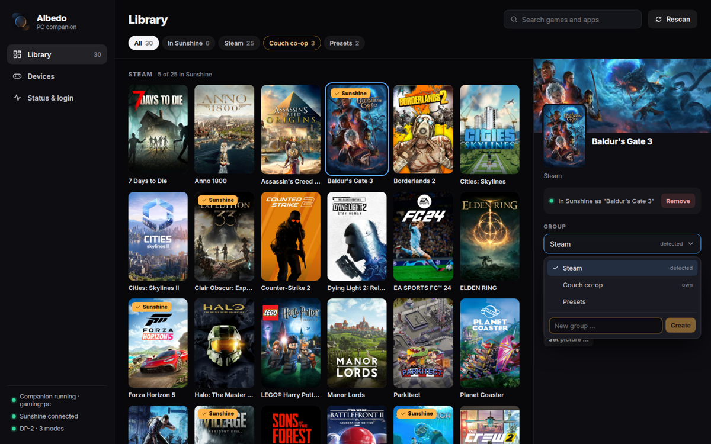

# Albedo Companion

The one program for the gaming PC (Tauri 2 + React + TypeScript). It runs the
[companion](../companion/) the Deck talks to (port 47995) and is the window to manage it with
mouse and keyboard, so you can do at the desk what the launcher on the Deck does from the couch:

<p align="center">
  
</p>


- **Library:** everything the companion found, by group (Steam, Non-Steam, Emulation, Heroic,
  Lutris, Minecraft, Apps, Presets), with covers and the *In Sunshine* state. Add and remove.
- **Group per game:** move a game into another group or into an own one ("Couch co-op"), or back
  to the detected group. The companion stores it, so the Deck shows the same groups.
- **Pictures:** set cover, title art or logo from the picture search (Steam shop, libretro,
  SteamGridDB with a key) or from a file (file picker or drag & drop), and reset them. The
  dialog stays open after setting one, so cover, title art and logo are done in one go.
- **Devices:** pair a Moonlight device with the PIN it shows; list and unpair paired devices.
- **Display:** the three routes a stream can take on this PC (virtual connector, dummy plug,
  main monitor): set up or not, connector, connected, and what *Automatic* picks. Pick the dummy
  plug's connector and the main monitor (saved in `~/.config/sunshine-match-client.conf`, the
  other lines stay). Modes of each route; the virtual connector can get new ones (KDE password
  prompt), a dummy plug or real monitor only has what its own EDID reports. *Test* switches a
  route once with the stream's code (steps, rollback), comes back after 10 s and shows the
  result; a warning comes first, since the other monitors go dark meanwhile. Setting the virtual
  connector up or removing it shows the installer command to copy (root, connector choice, KWin
  sees the connector come and go: better in a terminal than behind a click).
- **Status & login:** companion running, Sunshine reachable, the stream screen *Automatic* uses;
  Sunshine login; language (system, German, English) and SteamGridDB key (with a link to the
  key page; the companion stores it for this app and the Deck and checks it with a real
  SteamGridDB request).

## Tray, autostart and command line

| Command | What it does |
|---|---|
| `Albedo-Companion-x86_64.AppImage` | Companion + tray icon + window |
| `… --hidden` | The same, starting in the tray (the autostart entry `~/.config/autostart/albedo-companion.desktop` uses it) |
| `… --headless` | Only the companion: no window, no tray (PCs without a desktop) |
| `… --exit` | Ends the running instance (the installer uses it before an update) |
| `… quit "<pattern>"` | Undo step of a Sunshine app: ends the game's processes ([API.md](../companion/API.md)) |

Self-update: at start and every 6 hours the app looks for `latest-companion.json` on the latest
GitHub release (`plugins.updater` in `tauri.conf.json`, same signing key as the Deck app). An
update adds *Update verfügbar (x.y.z) – installieren* to the tray menu and a line to the
sidebar; the Deck can start it too (`POST /api/update`). It waits while Sunshine runs a game,
replaces the AppImage at `$APPIMAGE` and starts it again with `--hidden`
(`src-tauri/src/companion_updater.rs`). Only in the installed AppImage; `tauri dev` and
`--headless` report `unsupported`.

Single instance: a second start only shows the window of the running one. Closing the window
drops it with its webview, the app stays in the tray with the companion running; *Open* in the
tray menu builds the window again, *Quit* ends everything.

The window has no logic of its own: it calls the companion's HTTP API
([`companion/API.md`](../companion/API.md)) on `127.0.0.1` (port from the companion's config)
through its Rust side (the companion sends no CORS headers). The picture search is the Deck launcher's own code
(`src-tauri/src/art_search.rs` and friends), compiled into this app with `#[path]`, so both
find the same pictures.

## Run

Needs the repository's npm packages (`npm install` in the repository root; this app uses them).
The dev build serves the companion too, so quit an installed Albedo Companion first (both want port
47995), or set another `port` in a test `HOME`'s `~/.config/albedo-companion/config.json`.

```bash
cd pc-app
PATH=../node_modules/.bin:$PATH nice -n 19 tauri dev
```

Dev port is **1440** (1420/1430 are taken). `npm run dev` alone shows the UI in a browser at
`http://localhost:1440` with the data of the companion running on 47995 (Vite forwards
`/companion` to it; `ALBEDO_COMPANION_PORT=47996` points it at a test companion); the picture
search needs the Tauri app.

A test companion that never touches the monitors or your config: a test `HOME` with its own
`config.json` (`"port": 47996`) and `sunshine-match-client.conf`, started with
`HOME=… ALBEDO_DRY_RUN=1 src-tauri/target/debug/albedo-companion --headless`. With
`ALBEDO_DRY_RUN` a display test only logs the steps and a new mode skips the root prompt.

Build an AppImage / RPM:

```bash
cd pc-app
PATH=../node_modules/.bin:$PATH CARGO_BUILD_JOBS=4 nice -n 19 tauri build
```

## Layout

- `src/PcApp.tsx` – root class component, owns all state and every action
- `src/views/` – one file per screen or part, pure rendering (`DisplayScreen` with
  `DisplayRouteCard`, `DisplayTestPanel`, `ModeList`, `CommandBox` for the display area)
- `src/services/Companion.ts` – every call to the companion and the Rust side
- `src/i18n/` – `UiText`, `GermanTexts`, `EnglishTexts` (every visible text in both)
- `src/model/` – API types, placeholder tint
- `src-tauri/src/companion_proxy.rs` – HTTP client for the companion
- `src-tauri/src/main_window.rs` – the window, built on *Open*, dropped on close
- `src-tauri/src/tray_icon.rs` – tray icon and its menu
- `src-tauri/src/language_setting_file.rs` – the stored UI language
- `src-tauri/src/lib.rs` – command line, starts the companion thread, Tauri commands: `companion` (any endpoint), `upload_art` (file bytes),
  `search_art`, `apply_art`, `set_language`, `load_language_setting`, `save_language_setting`,
  `open_steam_grid_db_key_page`

The UI language lives in `~/.config/albedo-companion/ui-language` (the webview's localStorage is
not kept by release builds). The SteamGridDB key is the companion's (`config.json`, mode 600),
shared with the Deck; the picture search reaches SteamGridDB through the companion, which adds the key.
